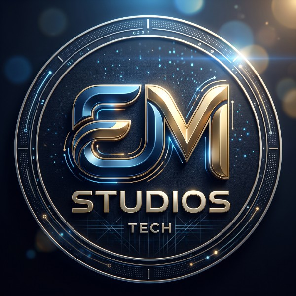

  

  # EM Studios
  ### Engineering Smart Digital Solutions & AI Innovations

  
  
  

  ---

  

    <b>EM Studios</b> is an innovative technology studio focused on transforming complex ideas into high-performance web applications, intelligent AI workflows, and modern digital products.
  

---

## 🚀 About Us

At **EM Studios**, we combine cutting-edge software engineering with smart automation and clean UI/UX design. We specialize in building scalable web architectures and automating business processes using modern AI technologies to empower startups and enterprises.

---

## 🛠️ Core Services & Capabilities

* **🌐 Web & Software Development:** High-speed, scalable web applications built with modern frameworks (React, TypeScript, Vite, Tailwind CSS).
* **🤖 AI & Workflow Automation:** End-to-end integration of AI models, API orchestration, and workflow automation (n8n, Activepieces, Groq, custom scripts).
* **🎨 UI/UX & Brand Identity:** Crafting modern, interactive, and user-centric interfaces.
* **☁️ Cloud & Infrastructure:** Deployment, custom DNS configuration, and secure API integration (Vercel, Cloudflare, Resend).

---

## 💻 Tech Stack

| Domain | Technologies |
| :--- | :--- |
| **Frontend** | React, TypeScript, Vite, Tailwind CSS, TanStack Router |
| **Backend & Cloud** | Node.js, Python, Firebase, Vercel, Cloudflare |
| **AI & Automation** | n8n, Activepieces, Groq API, LLM Fine-Tuning |
| **Design & Tools** | Figma, Git, GitHub Actions, Resend |

---

## 👥 Leadership

* **Founder & Lead AI Engineer:** [Ehab Alhayek](https://github.com/ethanmarten) (`he/him`)
  * 🌐 Website: [emstudios.tech](https://emstudios.tech)
  * ✉️ Contact: `support@emstudios.tech`

---

  © 2026 EM Studios. All rights reserved.

